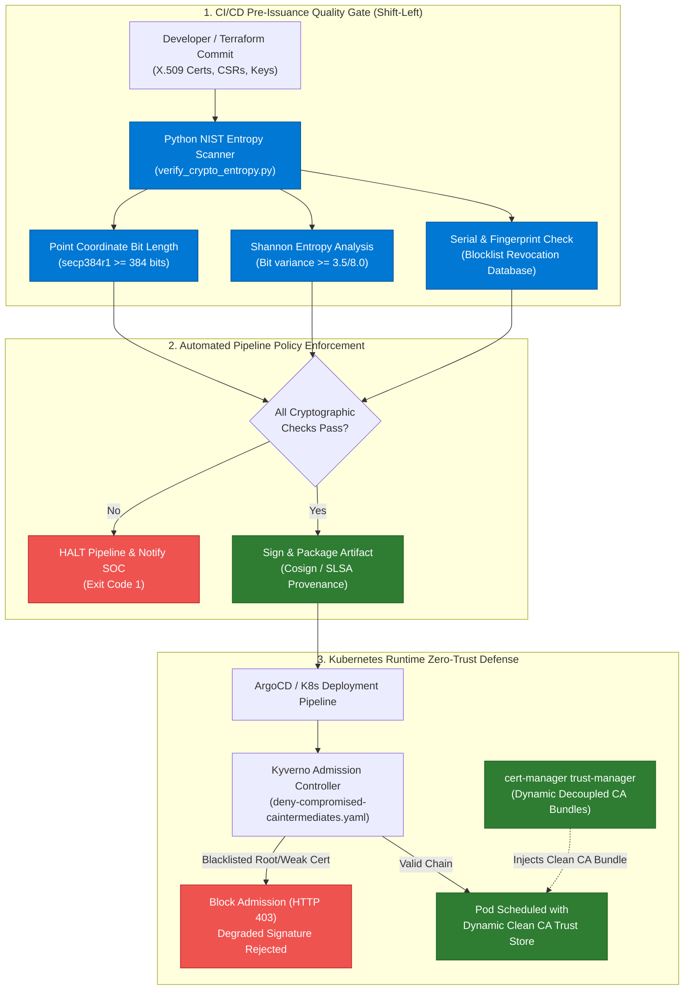

<div align="center">

# 🛡️ DevSecOps Cryptographic Resilience & Zero-Trust Defense

[](https://github.com/rahulgoyaldevops/devsecops-cryptographic-resilience)
[](docs/INCIDENT_POSTMORTEM_EMUDHRA_2026.md)
[](LICENSE)

**Enterprise Post-Mortem, Cryptographic Quality Gates & Admission Controller Defenses for Web-PKI & Supply-Chain Security**

*Architected and Implemented by [Rahul Goyal](https://github.com/rahulgoyaldevops) — Senior DevOps & DevSecOps Engineer (14+ Years Total IT Experience)*

</div>

---

## 📌 Architectural Background: The October 2026 Web-PKI Flaw

In October 2026, a critical cryptographic entropy defect in **eMudhra's intermediate Certificate Authorities** compromised eight globally trusted intermediate keys (6 TLS HTTPS and 2 Code Signing). 

A software defect in an HSM key-generation ceremony generated **P-384 Elliptic Curve private keys with scalar values smaller than 256 ($d < 256$)**, completely compromising the discrete logarithm problem and allowing attackers to calculate the private keys directly from public certificates in microseconds.

This repository implements the **complete enterprise DevSecOps defense lifecycle** to ensure zero-trust cryptographic supply chains, pre-issuance quality gates, and automated Kubernetes runtime isolation.

---

## 🏗️ End-to-End DevSecOps Architecture Flow



---

## 🚀 Key Defense Components Included

### 1. 🔍 Automated Cryptographic Pre-Issuance Quality Gate
* **File:** [`scripts/verify_crypto_entropy.py`](scripts/verify_crypto_entropy.py)
* **Standards:** NIST SP 800-56A Rev 3 & FIPS 186-5.
* **Capabilities:**
  * Computes Shannon bit-entropy of public coordinates $(x, y)$.
  * Inspects coordinate bit length to prevent small scalar / near-origin ECDSA generation.
  * Real-time verification against revoked serial lists.
  * Native pipeline exit codes (`0` for Pass, `1` for Pipeline Halt).

### 2. 🛡️ Kubernetes Admission Controller Policy (Supply-Chain Gate)
* **File:** [`kyverno/policies/deny-compromised-caintermediates.yaml`](kyverno/policies/deny-compromised-caintermediates.yaml)
* Intercepts pod creation and config maps at the Kubernetes API Server.
* Enforces container image signature verification (Cosign) against explicit authoritative root CAs.
* Blocks injection of blacklisted eMudhra 2026 intermediate SHA-256 fingerprint patterns.

### 3. ☸️ Dynamic In-Cluster Trust Store Synchronization
* **File:** [`kubernetes/trust-manager/cert-manager-trust-bundle.yaml`](kubernetes/trust-manager/cert-manager-trust-bundle.yaml)
* Decouples certificate trust stores from static operating system container images.
* Automatically syncs and updates trust bundles across namespaces without restarting workloads.
* Includes automated daily CronJob auditing cluster bundles against global OneCRL revocation feeds.

### 4. 🔄 Enterprise Multi-Stage CI/CD Pipelines
* **GitHub Actions:** [`.github/workflows/devsecops-crypto-pipeline.yml`](.github/workflows/devsecops-crypto-pipeline.yml)
* **Azure DevOps:** [`azure-pipelines/devsecops-crypto-azure-pipeline.yml`](azure-pipelines/devsecops-crypto-azure-pipeline.yml)
* Includes positive validation on compliant certificates and negative test gates that intentionally confirm defective keys are quarantined.

---

## 📖 In-Depth Incident Post-Mortem Documentation

For the full architectural dissection of the flaw, 5-Whys root cause analysis, mathematical discrete logarithm proof, and Day-2 operations runbooks, read the complete engineering whitepaper:

👉 **[Read the Full Enterprise Incident Post-Mortem (October 2026)](docs/INCIDENT_POSTMORTEM_EMUDHRA_2026.md)**

---

## 🧪 Local Execution & Validation

```bash
# 1. Install cryptographic dependencies
pip install cryptography==50.0.2

# 2. Test Compliant Enterprise Certificate (Passes Gate)
python scripts/verify_crypto_entropy.py samples/valid-certs/valid-enterprise-p384.crt

# 3. Test Compromised Intermediate Simulation (Fails Gate)
python scripts/verify_crypto_entropy.py samples/weak-certs/simulated-revoked-intermediate.crt
```

---

<div align="center">

**Designed & Maintained by [Rahul Goyal](https://github.com/rahulgoyaldevops)** — Senior DevOps & DevSecOps Engineer (14+ Years Total IT Experience)

[](https://www.linkedin.com/in/rahulgoyaldevops/)

</div>
